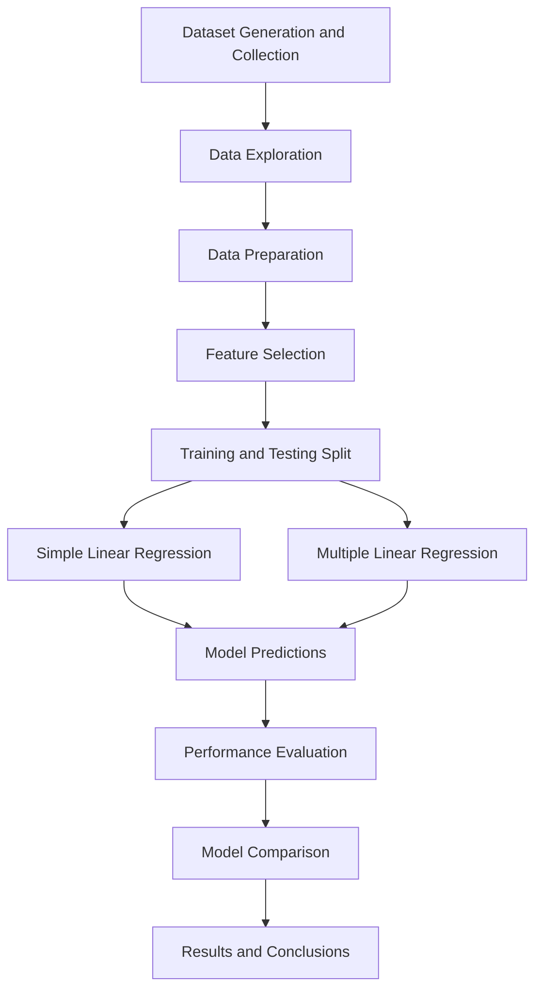

# 🐝 Beehive Honey Yield Prediction Using Linear Regression


\


> A machine learning project that predicts seasonal honey production using colony characteristics and environmental factors through Simple and Multiple Linear Regression.

---

## 📌 Project Overview

Honey production is influenced by several biological and environmental factors, including bee colony size, flowering resources, temperature and rainfall. Understanding the relationship between these factors and honey yield can support better decision-making in apiculture.

This project implements and compares two supervised machine learning algorithms:

- **Simple Linear Regression (SLR)**
- **Multiple Linear Regression (MLR)**

The primary objective is to evaluate how single-feature and multi-feature regression models perform when predicting seasonal honey yield.

The project demonstrates a regression-based machine learning workflow, from dataset preparation to model evaluation and comparative analysis.

---

## 📑 Table of Contents

- [Project Objectives](#-project-objectives)
- [Key Features](#-key-features)
- [Technology Stack](#-technology-stack)
- [Dataset Description](#-dataset-description)
- [Machine Learning Methodology](#-machine-learning-methodology)
- [Project Workflow](#-project-workflow)
- [Model Performance](#-model-performance)
- [Key Findings](#-key-findings)
- [Repository Structure](#-repository-structure)
- [Installation and Usage](#-installation-and-usage)
- [Applications](#-potential-applications)
- [Limitations](#-limitations)
- [Future Enhancements](#-future-enhancements)
- [Author](#-author)

---

## 🎯 Project Objectives

- Predict seasonal honey yield using regression-based machine learning techniques.
- Understand the relationship between honey production and environmental variables.
- Implement Simple Linear Regression using a single independent variable.
- Implement Multiple Linear Regression using multiple independent variables.
- Compare model performance using standard regression evaluation metrics.
- Evaluate model generalization through cross-validation.
- Demonstrate the practical application of machine learning in agriculture and apiculture.

---

## ✨ Key Features

- 📊 Structured dataset containing 500 beehive observations.
- 🧹 Data preparation for regression modelling.
- 📈 Single-variable and multivariable regression analysis.
- 🧠 Supervised machine learning implementation.
- 🔍 Comparative model performance evaluation.
- 📉 Quantitative error analysis.
- 🔄 Five-fold cross-validation.
- 🧪 Reproducible synthetic dataset generation.
- 📓 Interactive Jupyter Notebook implementation.

---

## 🛠️ Technology Stack

| Technology       | Purpose                                          |
| ---------------- | ------------------------------------------------ |
| Python           | Core programming language                        |
| Jupyter Notebook | Interactive development and experimentation      |
| Pandas           | Data manipulation and analysis                   |
| NumPy            | Numerical and mathematical operations            |
| Matplotlib       | Data visualization                               |
| Scikit-learn     | Machine learning and model evaluation            |
| Git              | Version control                                  |
| GitHub           | Source code management and project documentation |

---

## 📂 Dataset Description

**Dataset:** `Beehive_Honey_Yield.csv`

The dataset represents simulated beehive observations containing biological and environmental variables associated with seasonal honey production.

| Attribute          | Description           |
| ------------------ | --------------------- |
| Dataset type       | Synthetic / simulated |
| Total observations | 500                   |
| Total columns      | 7                     |
| Target variable    | Honey_Yield_kg        |
| Problem type       | Supervised learning   |
| ML task            | Regression            |
| File format        | CSV                   |

### Dataset Attributes

| Feature             | Data Type   | Description                                |
| ------------------- | ----------- | ------------------------------------------ |
| `Hive_ID`           | Numerical   | Unique identifier assigned to each beehive |
| `Apiary_Type`       | Categorical | Stationary, Migratory or Organic apiary    |
| `Colony_Size_k`     | Numerical   | Colony population in thousands of bees     |
| `Flowering_Area_ha` | Numerical   | Nearby flowering area in hectares          |
| `Avg_Temp_C`        | Numerical   | Average seasonal temperature in Celsius    |
| `Rainfall_mm`       | Numerical   | Average monthly rainfall in millimetres    |
| `Honey_Yield_kg`    | Numerical   | Seasonal honey production in kilograms     |

### Dataset Source

The dataset is synthetically generated for this machine learning project. It is not presented as an externally collected agricultural dataset.

- [View Dataset](./beehive-honey-yield-linear-regression/Beehive_Honey_Yield.csv)
- [Dataset Generation Script](./beehive-honey-yield-linear-regression/generate_dataset.py)

### Feature Selection

| Category                     | Variables                                                 |
| ---------------------------- | --------------------------------------------------------- |
| SLR feature                  | Flowering_Area_ha                                         |
| MLR features                 | Colony_Size_k, Flowering_Area_ha, Avg_Temp_C, Rainfall_mm |
| Target variable              | Honey_Yield_kg                                            |
| Excluded identifier          | Hive_ID                                                   |
| Excluded categorical feature | Apiary_Type                                               |

`Hive_ID` is an observation identifier rather than a predictive feature. `Apiary_Type` is excluded because it has no effect on the target variable by the dataset's generation design.

---

## 🧠 Machine Learning Methodology

### 1. Simple Linear Regression (SLR)

Simple Linear Regression establishes a linear relationship between one independent variable and a continuous dependent variable.

In this project, flowering area is used to predict honey yield.

**Mathematical representation:**

$$
\hat{y} = \beta_0 + \beta_1x
$$

Where:

- `ŷ` — Predicted honey yield.
- `β₀` — Intercept.
- `β₁` — Regression coefficient.
- `x` — Flowering area.

SLR serves as a baseline model for assessing the predictive capability of a single feature.

### 2. Multiple Linear Regression (MLR)

Multiple Linear Regression extends simple regression by incorporating multiple independent variables.

**Mathematical representation:**

$$
\hat{y} = \beta_0 + \beta_1x_1 + \beta_2x_2 + \beta_3x_3 + \beta_4x_4
$$

The model considers four input features:

- Colony size
- Flowering area
- Average temperature
- Rainfall

By incorporating multiple predictors, the model captures a broader range of relationships associated with honey production.

---

## 🔄 Project Workflow



### Machine Learning Pipeline

| Stage                | Description                                          |
| -------------------- | ---------------------------------------------------- |
| Data preparation     | Load and organize the dataset                        |
| Exploratory analysis | Understand feature characteristics and relationships |
| Feature selection    | Identify relevant independent variables              |
| Dataset splitting    | Separate training and testing observations           |
| Model training       | Fit SLR and MLR models                               |
| Prediction           | Estimate honey production                            |
| Evaluation           | Calculate regression performance metrics             |
| Validation           | Assess MLR using five-fold cross-validation          |
| Comparison           | Identify the better-performing regression model      |

---

## 📊 Model Performance

Both regression models are evaluated using 100 test observations.

### Evaluation Metrics

| Metric | Description                  | Preferred Value |
| ------ | ---------------------------- | --------------- |
| MAE    | Mean Absolute Error          | Lower           |
| MSE    | Mean Squared Error           | Lower           |
| RMSE   | Root Mean Squared Error      | Lower           |
| R²     | Coefficient of Determination | Higher          |

### Performance Comparison

| Evaluation Metric | Simple Linear Regression | Multiple Linear Regression |
| ----------------- | -----------------------: | -------------------------: |
| MAE               |                     5.96 |                   **4.26** |
| MSE               |                    53.78 |                  **28.49** |
| RMSE              |                     7.33 |                   **5.34** |
| R² Score          |                    0.693 |                  **0.838** |

### Performance Improvement

| Metric         |   Improvement with MLR |
| -------------- | ---------------------: |
| MAE reduction  |                 28.52% |
| MSE reduction  |                 47.03% |
| RMSE reduction |                 27.15% |
| R² improvement | 14.5 percentage points |

### R² Score Comparison

```text
Simple Linear Regression
██████████████░░░░░░  0.693

Multiple Linear Regression
█████████████████░░░  0.838
```

### Cross-Validation

| Parameter                | Result                     |
| ------------------------ | -------------------------- |
| Model                    | Multiple Linear Regression |
| Validation technique     | K-Fold Cross-Validation    |
| Number of folds          | 5                          |
| Mean cross-validation R² | 0.805                      |

The cross-validation result provides additional evidence of the model's predictive performance within the simulated dataset.

### 🏆 Best Performing Model

**Multiple Linear Regression (MLR)**

The MLR model explains approximately **83.8% of the variance in honey yield across the test observations**, while achieving lower prediction errors than Simple Linear Regression.

---

## 💡 Key Findings

- Multiple Linear Regression outperforms Simple Linear Regression across all reported evaluation metrics.
- Flowering area provides meaningful predictive information within the simulated dataset.
- Incorporating colony size, temperature and rainfall improves model performance.
- Multiple Linear Regression reduces RMSE by approximately 27.15% compared with the baseline model.
- Five-fold cross-validation produces a mean R² score of 0.805.
- Multivariable regression provides a more effective representation of the simulated honey production process.

---

## 📁 Repository Structure

```text
RCA-Project-1-AD3214/
│
├── beehive-honey-yield-linear-regression/
│   │
│   ├── Beehive_Honey_Yield.csv
│   ├── Beehive_Honey_Yield_Linear_Regression.ipynb
│   ├── requirements.txt
│   └── README.md
│
└── README.md
```

### File Description

| File                                          | Purpose                                      |
| --------------------------------------------- | -------------------------------------------- |
| `Beehive_Honey_Yield.csv`                     | Dataset used for training and evaluation     |
| `Beehive_Honey_Yield_Linear_Regression.ipynb` | Machine learning implementation and analysis |              |
| `requirements.txt`                            | Project dependencies                         |
| `README.md`                                   | Project documentation                        |

---

## 🚀 Installation and Usage

### Prerequisites

Ensure that the following software is installed:

- Python 3
- pip
- Git
- Jupyter Notebook or Visual Studio Code

### Step 1: Clone the Repository

```bash
git clone https://github.com/Prasadkhachane13/RCA-Project-1-AD3214.git
```

### Step 2: Navigate to the Project Directory

```bash
cd RCA-Project-1-AD3214
cd beehive-honey-yield-linear-regression
```

### Step 3: Install Dependencies

```bash
python -m pip install -r requirements.txt
```

### Step 4: Generate the Dataset (Optional)

The dataset is already included in the repository. Run the following command only if you want to regenerate it:


### Step 5: Launch Jupyter Notebook

```bash
jupyter notebook Beehive_Honey_Yield_Linear_Regression.ipynb
```

Alternatively, open the notebook using Visual Studio Code, select the appropriate Python kernel and execute the cells sequentially.

### Step 6: Execute the Project

Run all notebook cells to perform the regression analysis, generate predictions and compare model performance.

---

## 🌍 Potential Applications

With suitable real-world data and additional validation, this approach could support:

| Application            | Description                                           |
| ---------------------- | ----------------------------------------------------- |
| Smart Apiculture       | Data-driven beehive management                        |
| Agricultural Analytics | Analysis of environmental and biological factors      |
| Yield Forecasting      | Estimation of seasonal honey production               |
| Resource Planning      | Planning of flowering resources and colony management |
| Environmental Analysis | Investigation of weather-related production patterns  |
| Academic Research      | Demonstration of regression modelling techniques      |
| Precision Agriculture  | Development of predictive agricultural systems        |

---

## ⚠️ Limitations

- The dataset is synthetic rather than collected from real-world beehives.
- Model performance is dependent on the assumptions used during dataset generation.
- Linear regression may not capture complex nonlinear relationships.
- Factors such as bee diseases, pesticide exposure and humidity are not included.
- The reported evaluation metrics do not establish real-world predictive reliability.
- Additional field data and external validation are required before practical agricultural deployment.

---


---

## 🎓 Learning Outcomes

This project demonstrates practical knowledge of:

- Supervised machine learning.
- Simple and Multiple Linear Regression.
- Data preprocessing and feature selection.
- Exploratory data analysis.
- Training and testing methodology.
- Regression evaluation metrics.
- Cross-validation techniques.
- Comparative model analysis.
- Reproducible machine learning workflows.
- Professional project documentation.

---


## ⭐ Support

If you find this project informative or useful, consider starring the repository and sharing it with others interested in machine learning and agricultural analytics.

\


---

**Built with Python, Machine Learning and a passion for data-driven problem-solving.** 🐝
